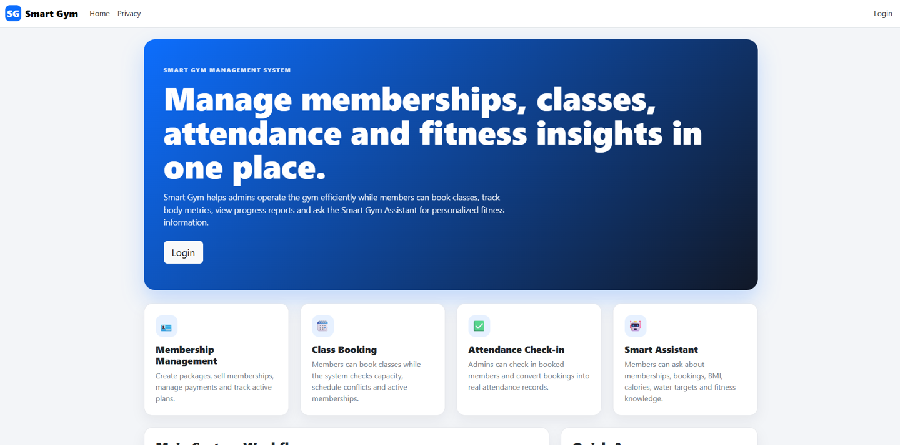
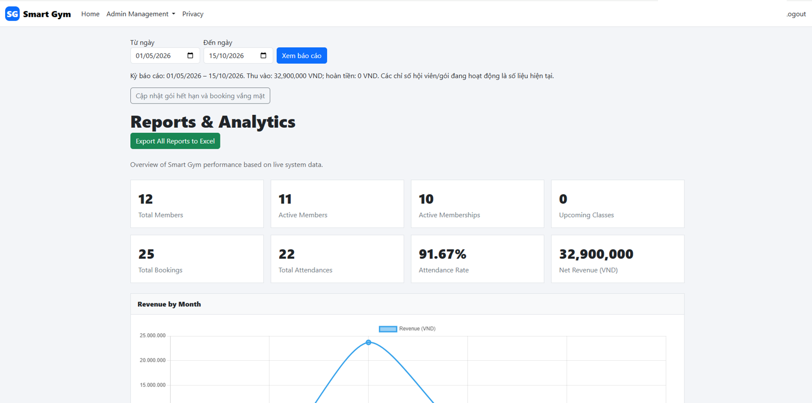
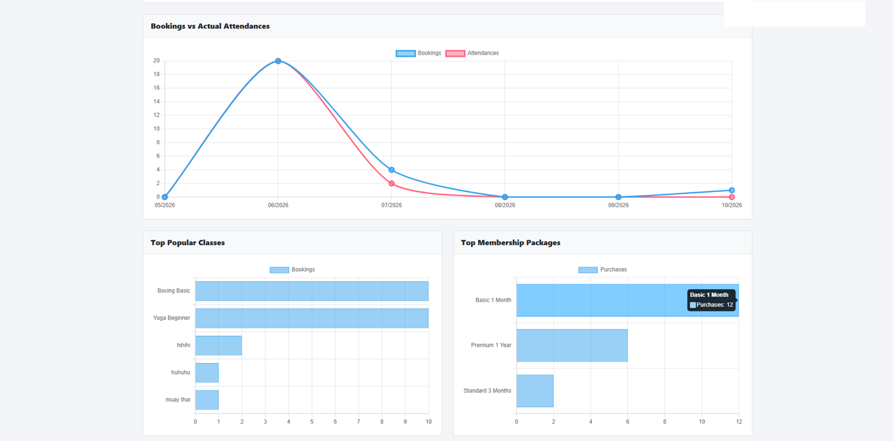
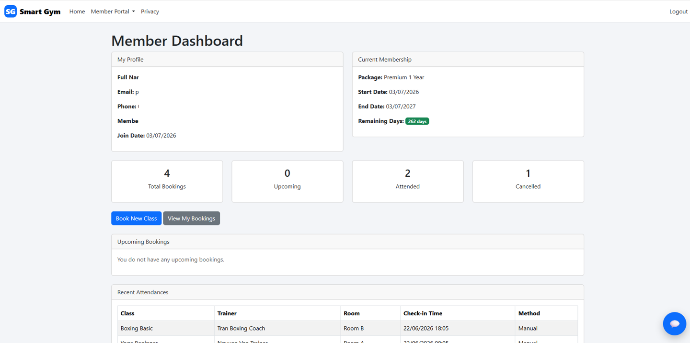
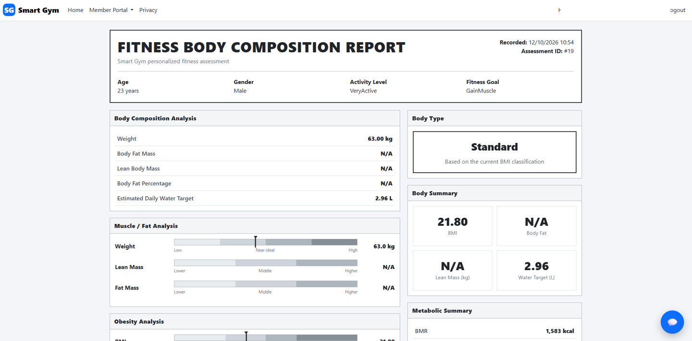
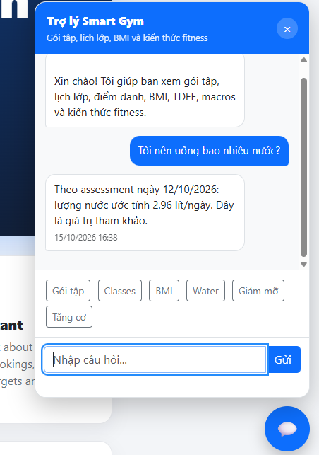

# SmartGym Management System

A web-based gym management application developed as an academic project using **ASP.NET Core MVC** and **SQL Server**. It brings together day-to-day gym administration and member-facing features in one application.

## Project Overview

SmartGym Management supports gym operations such as member and trainer administration, membership packages, class scheduling, attendance tracking, and self-service fitness features.

## Technology Stack

| Area | Technologies |
| --- | --- |
| Language | C# |
| Framework | ASP.NET Core MVC (.NET 10) |
| Front-end | Razor Views, HTML, CSS, JavaScript |
| ORM | Entity Framework Core |
| Database | Microsoft SQL Server / LocalDB |
| Authentication | ASP.NET Core Identity |
| Development tools | Visual Studio, EF Core migrations |

## Main Features

- **Gym administration:** CRUD management for members, trainers, membership packages, and training rooms.
- **Class scheduling:** Class and room management with validation to prevent scheduling conflicts.
- **Member portal:** Membership status, class bookings, and attendance history.
- **Reports and analytics:** Admin reporting dashboard for members, bookings, attendance and revenue, with charts and an Excel export action.
- **Fitness assessment:** BMI and metabolism-related metrics presented in a fitness assessment report.
- **Smart assistant:** In-app chat interface for gym-related questions and personalized fitness information.

## Application Screenshots

### 1. Home Page
Landing page introducing the gym management system and its major modules.



### 2. Admin Reports Dashboard
An overview of members, bookings, attendance, revenue, and report filters.



### 3. Analytics and Trends
Charts comparing class bookings with attendance, popular classes, and membership package purchases.



### 4. Member Dashboard
Member portal showing membership details, booking summary, and recent attendance records.



### 5. Fitness Assessment
Fitness body composition report including BMI, estimated water target, and metabolic indicators.



### 6. Smart Gym Assistant
Chat interface answering gym and fitness-related questions using the member's available assessment information.



## Project Structure

```text
SmartGym-Management/
├── Areas/
├── Controllers/
├── Data/
├── Migrations/
├── Models/
├── Security/
├── Services/
├── Tests/
├── Validation/
├── Views/
├── wwwroot/
├── Program.cs
└── SmartGymManagement.csproj
```

## Getting Started

### Requirements
- .NET 10 SDK
- SQL Server or SQL Server LocalDB
- Visual Studio or another .NET-compatible IDE

### Local setup

```bash
git clone https://github.com/phulocccc/SmartGym-Management.git
cd SmartGym-Management
dotnet restore
```

Configure your local SQL Server connection using the app's configuration mechanism. **Never commit database credentials or API keys.**

```bash
# Install only if not already installed
dotnet tool install --global dotnet-ef

dotnet ef database update
dotnet run
```

Open the local address printed in your terminal. Some features require an authenticated user with the appropriate role; additional local setup or seed data may be necessary.

## Development Notes

This is an academic project. The screenshots illustrate features visible in the application at the time of capture. Some modules may still be under development, and setup procedures can vary by environment.

## Author

**Nguyen Phu Loc**  
GitHub: [@phulocccc](https://github.com/phulocccc)
